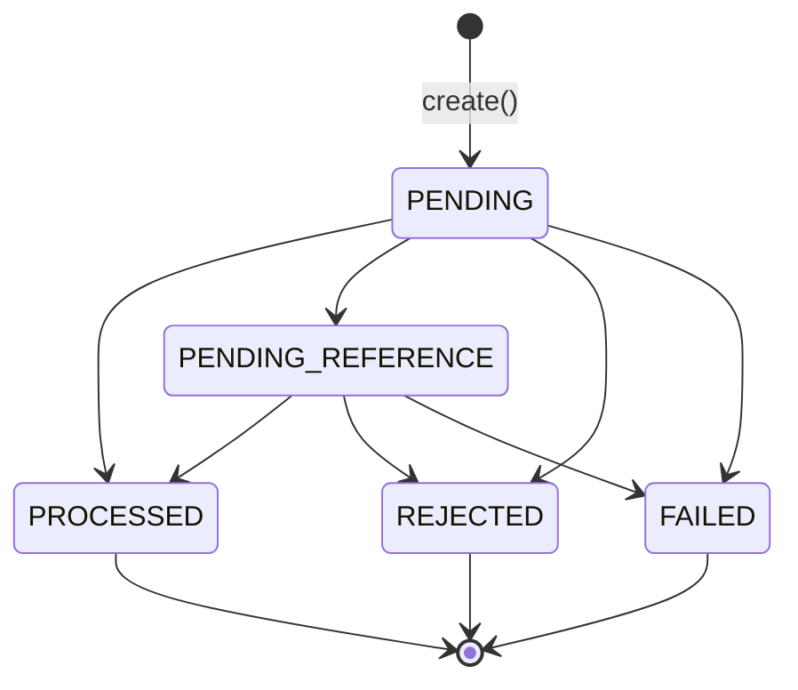

# Arquitetura

Este documento registra as decisões técnicas do Distributed Wagering Processor à medida que são tomadas: o contexto, a escolha e o que ela implica.

**Estado atual:** o domínio está completo e coberto por testes de unidade, mas ainda não está ligado à persistência nem à API.

## Estrutura

```
src/
  domain/          TypeScript puro: money, wallet, wagering, events, messaging, shared
  application/     use cases e portas
  infrastructure/  config, observabilidade, persistência (MikroORM), SQS
  interfaces/      HTTP (health, correlation id)
test/
  unit/            sem dependências externas
  integration/     PostgreSQL e MiniStack reais
  support/         bancos e filas descartáveis, processo real da aplicação, waitFor
```

A regra de dependência (`domain ← application ← infrastructure/interfaces`) é verificada por [um teste de arquitetura](test/unit/architecture/boundaries.test.ts). O domínio e a aplicação não podem importar Nest, MikroORM, AWS SDK, pino, zod nem as camadas externas, inclusive em imports só de tipo.

## Decisões

### D1. Runtime, framework e compilação

- O Bun 1.4.4 executa TypeScript direto, sem etapa de build. O framework é o NestJS 12 (ESM).
- O TypeScript 7 (compilador nativo) só faz o type-check (`bun run typecheck`), porque o Bun transpila sem checar tipos.
- O Nest usa decorators legados com `emitDecoratorMetadata`. Verificamos que o Bun emite o `design:paramtypes` que a injeção por classe exige.
- `verbatimModuleSyntax` impede que o import de uma classe usada na injeção seja apagado. Por isso a regra `useImportType` do Biome está desligada: ela converteria esses imports em `import type` e quebraria a injeção.

### D2. Emulador SQS: MiniStack, não LocalStack

- **Contexto:** a LocalStack atual (2026.10.8) encerra com código 55 sem `LOCALSTACK_AUTH_TOKEN`. Usá-la obrigaria quem avalia o projeto a criar uma conta.
- **Decisão:** MiniStack 1.5.41, livre e compatível com a API do SQS na mesma porta 4566. O endpoint vem de `SQS_ENDPOINT`, então trocar de emulador ou usar a AWS real não muda código.
- **Verificado** em [test/integration/infra/sqs.test.ts](test/integration/infra/sqs.test.ts), porque o resto do desenho depende disso:
  - dedup FIFO por `MessageDeduplicationId`;
  - ordem por `MessageGroupId` e bloqueio do grupo enquanto há mensagem em voo;
  - `ChangeMessageVisibility` com `ApproximateReceiveCount` crescente;
  - redrive para a DLQ depois de `maxReceiveCount`.

### D3. PostgreSQL 18 e MikroORM 7

O MikroORM é o ORM preferencial do enunciado. Três comportamentos da versão 7, verificados em [test/integration/infra/postgres.test.ts](test/integration/infra/postgres.test.ts), afetam o desenho:

1. **`numeric` chega como string.** O driver só reescreve os parsers de data, timestamp e interval. Valores como `99999999999999999.99` voltam exatos, e dinheiro nunca passa por `number`.
2. **Lock timeout não tem exceção própria.** O SQLSTATE `55P03` chega como `DriverException` genérica com `code = '55P03'`, e não como `LockWaitTimeoutException`. Já `40001` e `40P01` viram `DeadlockException`. O classificador de erros transitórios decide pelo SQLSTATE, não pela classe.
3. **A conexão é preguiçosa.** `MikroORM.init` não conecta; a primeira query é que abre o pool. A aplicação sobe com o banco fora do ar e o readiness acusa a falha. Antes da primeira query, `checkConnection()` responde "Connection not established", por isso o readiness faz um `select 1` real.

Configuração adotada:
- `allowGlobalContext: false`: todo acesso ao `EntityManager` passa por um fork explícito.
- `ensureDatabase: false`: a aplicação nunca cria banco.
- `forceUtcTimezone: true`.

### D4. Migrations

- O SQL é escrito à mão em `up()` e `down()`, porque índices parciais, triggers e constraints compostas não saem do diff do ORM.
- As migrations ficam numa lista explícita (`migrationsList`), sem glob nem snapshot.
- O executor é programático (`bun run db:migrate`, `db:rollback`, `db:pending`). No compose ele roda como serviço one-shot antes da aplicação, o que evita corrida entre réplicas aplicando migrations ao mesmo tempo.
- Há um teste que faz up → down → up num banco descartável.

### D5. Observabilidade (base)

- **Logs:** pino em JSON no stdout. O contexto de correlação (`correlationId`, `messageId`, `transactionId`, `walletId`, `providerId`) vive num `AsyncLocalStorage` e entra em todo log pelo `mixin`.
- **Redação:** `payload`, `body`, `money`, `amount`, `balance` e `authorization` saem como `[REDACTED]`.
- **`X-Correlation-Id`:** é aceito se tiver até 128 caracteres de um conjunto seguro; caso contrário, é gerado um UUIDv7. O id sempre volta na resposta.
- **Health:** `/health/live` não consulta dependências. `/health/ready` faz `select 1` no PostgreSQL e `GetQueueUrl` no SQS, cada um com timeout próprio (`HEALTH_CHECK_TIMEOUT_MS`), e responde 503 se algum falhar.
- **Shutdown:** no SIGTERM, o Nest roda os hooks, fecha o cliente SQS e o pool do banco e termina. Com `docker stop`, isso leva cerca de 0,3 s.

### D6. Testes e ferramentas

- Os testes de integração usam PostgreSQL e MiniStack reais, sem mocks. Cada suíte cria um banco próprio e filas com nome único e remove tudo no fim. As filas não são reaproveitadas porque `PurgeQueue` só pode rodar a cada 60 s.
- O teste de shutdown sobe a aplicação como processo real (`Bun.spawn`) e lê os logs JSON do stdout.
- O Biome cuida do lint e da formatação, só em `src/`, `test/` e nos JSONs da raiz.
- O CI (GitHub Actions) roda typecheck, lint e testes de unidade, e depois os testes de integração contra o compose.

### D7. Money em `bigint` de centavos

- **Representação:** o valor é um inteiro de unidades mínimas em `bigint`, com escala fixa de 2. Soma e subtração são exatas, sem biblioteca, e o `decimal.js` (que exigiria configurar precisão global) fica dispensado. Nenhum `number` toca dinheiro.
- **Contrato de entrada** (`Money.from`): `amount` é uma string não negativa com **exatamente** 2 casas, sem sinal, espaços, expoente ou zeros à esquerda. Cada recusa tem um motivo próprio (`MALFORMED`, `EMPTY`, `NEGATIVE`, `INVALID_SCALE`, `TOO_MANY_DECIMALS`, `OUT_OF_RANGE`, `INVALID_CURRENCY`). Valor com 3 casas é recusado, nunca arredondado: não existe arredondamento em lugar nenhum.
- **Faixa:** a mesma da coluna `numeric(20,2)`, 18 dígitos inteiros. Uma conta que passe disso lança `MoneyOutOfRangeError` antes de qualquer mudança de estado.
- **Moeda:** três letras maiúsculas, sem lista fixa de códigos ISO. O desafio roda em `BRL`, mas o modelo é multimoeda, e operações entre moedas diferentes lançam `CurrencyMismatchError`. `equals` entre moedas diferentes devolve `false`, sem lançar.
- **Imutabilidade:** a instância é congelada (`Object.freeze`).

### D8. Wallet e ledger

- **Saldo só muda com lançamento.** `Wallet.debit()` e `credit()` criam o `WalletLedgerEntry` dentro do agregado e o devolvem. Saldo, versão e lançamento mudam juntos, e só depois que o lançamento foi validado.
- **Versão:** começa em 1 na abertura (com o crédito de abertura, quando há saldo inicial) e só incrementa quando o saldo muda. Cada lançamento grava a `walletVersion` resultante. Isso encadeia o ledger sem bifurcação (o `UNIQUE (wallet_id, wallet_version)` garante isso no banco) e serve de cursor estável para a paginação.
- **Débito sem saldo:** `debit()` lança `InsufficientFundsError` como guarda da invariante. Quem decide a rejeição de negócio, e com qual código, é o serviço de regras (D10), que consulta `canDebit()` antes.
- **Imutabilidade estrutural do lançamento:** campos `readonly`, instância congelada, datas guardadas como instante (porque `Date` é mutável) e nenhum método de transição. Um teste garante que o protótipo só tem `isBalanced`, `signedAmount` e o getter de data. `create()` valida que `balanceBefore ± money === balanceAfter`, valor positivo, saldos não negativos e moeda única.

### D9. WagerTransaction e máquina de estados



- **Terminais:** `PROCESSED`, `REJECTED` e `FAILED` não saem do lugar. Qualquer transição a partir deles lança `InvalidTransactionStateError`, e há um teste para cada combinação.
- **`PENDING`:** no fluxo síncrono é estado só de memória. A transação nasce `PENDING` e é decidida na mesma transação SQL em que é gravada.
- **`FAILED`:** reservado a erro permanente de infraestrutura numa transação que já estava persistida (por exemplo, no worker de pendências).
- **`OPENING`:** não passa por `create()`, que o recusa. Existe uma fábrica interna, `WagerTransaction.opening()`, no provider reservado `system`, que nenhum provedor externo pode usar.
- **`payloadHash`** é derivado dos campos na criação, então nunca diverge deles. O algoritmo é o SHA-256 (hex) do JSON canônico do subconjunto de negócio: `providerId`, `externalTransactionId`, `playerId`, `walletId`, `roundId`, `gameId`, `kind`, `money` e `referenceExternalTransactionId`. O JSON canônico ordena as chaves em todos os níveis, não tem espaços e omite campos ausentes; como todos os valores são strings, coincide com o JCS da RFC 8785. Um vetor fixo, calculado fora do código com `sha256sum`, trava o algoritmo em teste: mudá-lo sem querer quebraria a idempotência entre versões.
- **Saldo observado:** cada decisão grava o saldo da wallet naquele momento (`observedBalance`), que é o que um replay devolve.

### D10. Regras de negócio (`WagerSettlement`)

Um serviço de domínio recebe a transação, a wallet já travada e a referência já resolvida pela aplicação: ausente, ou encontrada com a informação "já revertida". Ele decide o desfecho e aplica as transições. Persistir e publicar fica com a aplicação. As checagens seguem esta ordem:

1. Player diferente do dono da wallet → `PLAYER_WALLET_MISMATCH`.
2. Moeda diferente da wallet → `CURRENCY_MISMATCH`.
3. Referência, quando a transação tem uma:
   - ausente ou ainda não terminal → `PENDING_REFERENCE`, com a próxima busca agendada;
   - terminal mas não `PROCESSED` → `REFERENCE_NOT_PROCESSED`;
   - tipo não aceito → `REFERENCE_KIND_NOT_ALLOWED`;
   - outro provider, player, wallet, moeda ou rodada → `REFERENCE_MISMATCH`;
   - já revertida → `REFERENCE_ALREADY_REVERSED`;
   - REFUND/ROLLBACK com valor diferente → `REVERSAL_AMOUNT_MISMATCH`.
4. Efeito no saldo: LOSS não move saldo; BET debita; WIN e REFUND creditam; ROLLBACK inverte a direção da referência. Um débito sem saldo vira `INSUFFICIENT_FUNDS` numa BET e `REVERSAL_INSUFFICIENT_FUNDS` numa reversão.

**Referências fora de ordem:** a busca é repetida com backoff exponencial (1 s, 2 s, 4 s… até 60 s) e TTL de 15 min contados da criação. O TTL cobre com folga a janela de retry da mensagem referenciada na fila (5 recebimentos com backoff, cerca de 1 min) e os reenvios HTTP do provedor. Esgotado o prazo, a rejeição é `REFERENCE_NOT_FOUND`, ou `REFERENCE_NOT_PROCESSED` se a referência existe mas nunca terminou.

### D11. Códigos de falha

Os códigos são separados já no tipo: `reject()` só aceita `RejectionCode` e `fail()` só aceita `InfrastructureFailureCode`.

| Código | Estado | Significado | O provedor deve |
|---|---|---|---|
| `INSUFFICIENT_FUNDS` | REJECTED | BET maior que o saldo | desistir |
| `REVERSAL_INSUFFICIENT_FUNDS` | REJECTED | reversão de crédito que deixaria o saldo negativo | escalar (o saldo já foi gasto) |
| `CURRENCY_MISMATCH` | REJECTED | moeda da operação ≠ moeda da wallet | corrigir e reenviar com novo id |
| `PLAYER_WALLET_MISMATCH` | REJECTED | o player não é dono da wallet | corrigir e reenviar com novo id |
| `REFERENCE_NOT_FOUND` | REJECTED | a referência não apareceu dentro do TTL | reenviar a referência e a operação com novo id |
| `REFERENCE_NOT_PROCESSED` | REJECTED | a referência foi rejeitada, falhou ou não terminou | desistir |
| `REFERENCE_MISMATCH` | REJECTED | referência de outro provider, player, wallet, moeda ou rodada | corrigir |
| `REFERENCE_KIND_NOT_ALLOWED` | REJECTED | tipo de referência não aceito (ex.: REFUND de WIN) | corrigir |
| `REFERENCE_ALREADY_REVERSED` | REJECTED | a referência já tem um REFUND ou ROLLBACK processado | desistir |
| `REVERSAL_AMOUNT_MISMATCH` | REJECTED | valor da reversão ≠ valor da referência | corrigir |
| `INVARIANT_VIOLATION` | FAILED | o banco recusou o resultado por uma invariante (bug) | escalar |
| `PROCESSING_FAILED` | FAILED | erro não recuperável ao reprocessar | escalar |

Erros de contrato não viram transação; na API eles viram respostas 400 com o motivo. São os motivos de `InvalidMoneyError` (D7) e de `InvalidWagerTransactionError`: `KIND_NOT_ALLOWED`, `RESERVED_PROVIDER`, `MISSING_FIELD`, `REFERENCE_REQUIRED`, `REFERENCE_NOT_ALLOWED`, `SELF_REFERENCE` e `INVALID_AMOUNT`.

### D12. Eventos, inbox e outbox no domínio

- **Eventos:** `IntegrationEvent` é abstrata, com uma subclasse por evento que fixa `eventType` e `version` no tipo. `data` só leva `MoneyProps`, nunca `Money`, e é clonado e congelado. O `aggregateId` é o `transactionId` nos eventos de transação e o `walletId` no `WalletBalanceChanged`. Como o `MessageGroupId` da publicação será o `aggregateId`, a ordem por wallet se mantém onde importa; e a `walletVersion` no evento permite ordenar mesmo assim.
- **Outbox:** o id da mensagem é o `eventId`, então republicar carrega o mesmo id, e é por ele que o consumidor deduplica. A mensagem nasce devida e, a cada falha, `scheduleRetry()` aplica backoff exponencial com jitter. Não há limite de tentativas: evento confirmado nunca é descartado, e o atraso aparece como outbox lag. O último erro fica guardado, truncado.
- **Inbox:** a mensagem é identificada por `(consumerName, messageId)` e só pode ser marcada como processada uma vez. `matchesPayload()` detecta reuso de `messageId` com outro conteúdo.

## Interpretações adotadas

Pontos que o enunciado deixa em aberto e como foram decididos:

- **Formato do `amount`:** exatamente 2 casas na entrada (o contrato fala em escala fixa). BET, WIN, REFUND e ROLLBACK exigem valor maior que zero; LOSS aceita `0.00`.
- **Uma reversão por referência:** uma transação aceita no máximo **uma** reversão `PROCESSED`, de qualquer tipo. É mais restrito que a regra 4 da seção 7 ("pelo mesmo tipo"), mas impede que um REFUND mais um ROLLBACK da mesma BET creditem duas vezes. Uma reversão desfeita por ROLLBACK não reabre a referência.
- **Referência já revertida:** também não serve de base para um WIN, porque não se paga prêmio de aposta devolvida. LOSS, que não move saldo, continua sendo registrado.
- **Referência em WIN e LOSS:** é opcional. Se vier, deve ser uma BET e passa pelas mesmas validações; a transação pode ficar `PENDING_REFERENCE`.
- **BET com referência:** é recusada como contrato inválido.
- **Wallet inexistente:** 404, sem persistir (não há wallet onde registrar). Player diferente do dono da wallet: `REJECTED` persistido, para auditoria.
- **Escopo da key:** o `Idempotency-Key` vale por provedor. A unicidade financeira vale por `(providerId, externalTransactionId)`, independente da key.
- **Evento do `OPENING`:** o crédito de abertura emite `WalletBalanceChanged`, para que todo lançamento tenha um evento correspondente.

## Trade-offs registrados

- **Reversão única é conservadora.** Se um REFUND for desfeito por ROLLBACK, a BET não pode ser devolvida de novo; o provedor teria de usar outra operação. Preferimos recusar um caso raro a arriscar crédito duplicado.
- **Referência que chega depois do TTL** encontra a transação dependente já `REJECTED`, e a dependente não é reaberta (estados terminais são imutáveis). O TTL é longo justamente para isso, e o caso fica visível pelo evento `WagerTransactionRejected`.

- **Readiness inclui o SQS** porque o enunciado pede (seção 9). A API conseguiria aceitar transações com o SQS fora, já que os eventos ficam na outbox. Em produção, o readiness seria separado por papel (API, consumer, publisher).
