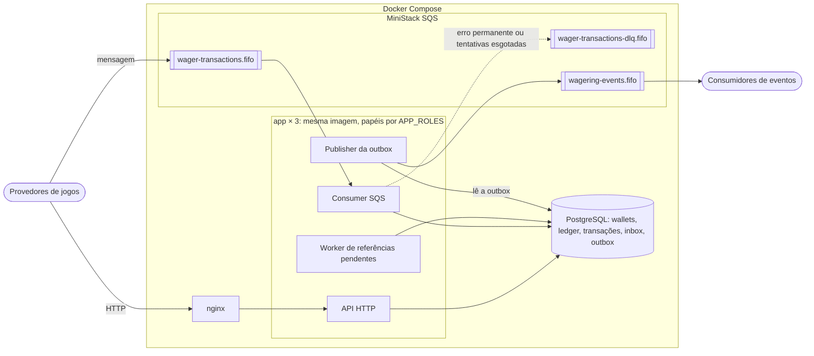
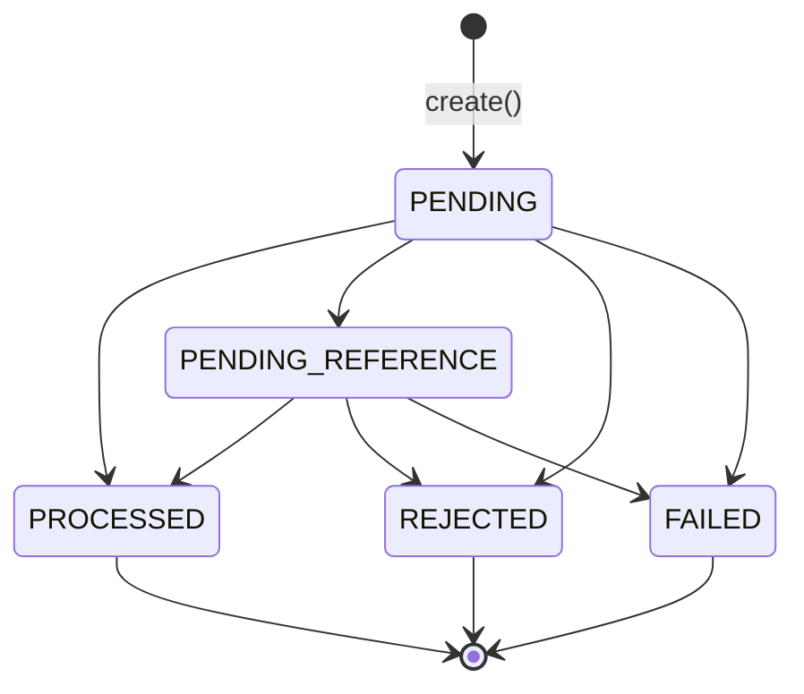

# Arquitetura

Este documento registra as decisões técnicas do Distributed Wagering Processor à medida que são tomadas: o contexto, a escolha e o que ela implica.

**Estado atual:**
- Os 8 cenários de concorrência da seção 13 passam com paralelismo real, inclusive com processos reais morrendo no meio do caminho.
- O compose sobe 3 réplicas atrás de um nginx, com a aplicação conectada por um usuário de privilégio mínimo, e `/metrics` expõe as métricas da seção 12.
- A autenticação ficou de fora por decisão; o desenho e o ponto de extensão estão na [D26](#d26-autenticação).
- O teste de carga (opcional) não foi feito. O que falta para produção está em [Limitações conhecidas e próximos passos](#limitações-conhecidas-e-próximos-passos).

## Visão geral



1. **Mesmo use case:** uma transação entra por HTTP ou pela fila e passa pelo mesmo `SubmitWagerTransaction`.
2. **Uma transação SQL:** a decisão, o lançamento no ledger, o saldo, a inbox e os eventos da outbox são gravados juntos no PostgreSQL.
3. **Só depois do commit:** a mensagem da fila é confirmada, e os eventos saem pela outbox.
4. **Coordenação no banco:** qualquer réplica processa qualquer transação. Quem coordena as instâncias é o banco (lock da wallet, unicidade, `SKIP LOCKED`), não a memória do processo.

## Estrutura

```
src/
  domain/          TypeScript puro: money, wallet, wagering, events, messaging, shared
  application/     use cases (wallets, wagering, messaging), portas (persistência, relógio, ids, métricas,
                   identidade do provedor) e erros de aplicação
  infrastructure/  config, observabilidade, persistência (schema, mappers, repositórios, migrations), SQS
  interfaces/      contratos de entrada (zod), HTTP (controllers, Problem Details, health, guard do provedor),
                   messaging (consumer SQS, módulo dos workers), workers (laço de polling)
  use-cases.module.ts  raiz de composição: monta os use cases (classes sem Nest) com as portas concretas
test/
  unit/            sem dependências externas
  integration/     PostgreSQL e MiniStack reais
  concurrency/     paralelismo real e processos reais da aplicação
  support/         bancos e filas descartáveis, processo real da aplicação, waitFor
scripts/           envio de mensagem de exemplo, leitura da DLQ e helpers da demonstração
infra/             nginx e o usuário de banco da aplicação
```

A regra de dependência (`domain ← application ← infrastructure/interfaces`) é verificada por [um teste de arquitetura](test/unit/architecture/boundaries.test.ts). O domínio e a aplicação não podem importar Nest, MikroORM, AWS SDK, pino, zod nem as camadas externas, inclusive em imports só de tipo.

## Decisões

### D1. Runtime, framework e compilação

- O Bun 1.4.4 executa TypeScript direto, sem etapa de build. O framework é o NestJS 12 (ESM).
- O TypeScript 7 (compilador nativo) só faz o type-check (`bun run typecheck`), porque o Bun transpila sem checar tipos.
- O Nest usa decorators legados com `emitDecoratorMetadata`. Verificamos que o Bun emite o `design:paramtypes` que a injeção por classe exige.
- `verbatimModuleSyntax` impede que o import de uma classe usada na injeção seja apagado. Por isso a regra `useImportType` do Biome está desligada: ela converteria esses imports em `import type` e quebraria a injeção.

### D2. Emulador SQS: MiniStack, não LocalStack

- **Contexto:** a LocalStack atual (2026.10.8) encerra com código 55 sem `LOCALSTACK_AUTH_TOKEN`. Usá-la obrigaria quem avalia o projeto a criar uma conta.
- **Decisão:** MiniStack 1.5.41, livre e compatível com a API do SQS na mesma porta 4566. O endpoint vem de `SQS_ENDPOINT`, então trocar de emulador ou usar a AWS real não muda código.
- **Verificado** em [test/integration/infra/sqs.test.ts](test/integration/infra/sqs.test.ts), porque o resto do desenho depende disso:
  - dedup FIFO por `MessageDeduplicationId`;
  - ordem por `MessageGroupId` e bloqueio do grupo enquanto há mensagem em voo;
  - `ChangeMessageVisibility` com `ApproximateReceiveCount` crescente;
  - redrive para a DLQ depois de `maxReceiveCount`.

### D3. PostgreSQL 18 e MikroORM 7

O MikroORM é o ORM preferencial do enunciado. Três comportamentos da versão 7, verificados em [test/integration/infra/postgres.test.ts](test/integration/infra/postgres.test.ts), afetam o desenho:

1. **`numeric` chega como string.** O driver só reescreve os parsers de data, timestamp e interval. Valores como `99999999999999999.99` voltam exatos, e dinheiro nunca passa por `number`.
2. **Lock timeout não tem exceção própria.** O SQLSTATE `55P03` chega como `DriverException` genérica com `code = '55P03'`, e não como `LockWaitTimeoutException`. Já `40001` e `40P01` viram `DeadlockException`. O classificador de erros transitórios decide pelo SQLSTATE, não pela classe.
3. **A conexão é preguiçosa.** `MikroORM.init` não conecta; a primeira query é que abre o pool. A aplicação sobe com o banco fora do ar e o readiness acusa a falha. Antes da primeira query, `checkConnection()` responde "Connection not established", por isso o readiness faz um `select 1` real.

Configuração adotada:
- `allowGlobalContext: false`: todo acesso ao `EntityManager` passa por um fork explícito.
- `ensureDatabase: false`: a aplicação nunca cria banco.
- `forceUtcTimezone: true`.

### D4. Migrations

- O SQL é escrito à mão em `up()` e `down()`, porque índices parciais, triggers e constraints compostas não saem do diff do ORM.
- As migrations ficam numa lista explícita (`migrationsList`), sem glob nem snapshot.
- O executor é programático (`bun run db:migrate`, `db:rollback`, `db:pending`). No compose ele roda como serviço one-shot antes da aplicação, o que evita corrida entre réplicas aplicando migrations ao mesmo tempo.
- Há um teste que faz up → down → up num banco descartável.

### D5. Observabilidade (base)

- **Logs:** pino em JSON no stdout. O contexto de correlação (`correlationId`, `messageId`, `transactionId`, `walletId`, `providerId`) vive num `AsyncLocalStorage` e entra em todo log pelo `mixin`.
- **Redação:** `payload`, `body`, `money`, `amount`, `balance` e `authorization` saem como `[REDACTED]`.
- **`X-Correlation-Id`:** é aceito se tiver até 128 caracteres de um conjunto seguro; caso contrário, é gerado um UUIDv7. O id sempre volta na resposta.
- **Health:** `/health/live` não consulta dependências. `/health/ready` faz `select 1` no PostgreSQL e `GetQueueUrl` no SQS, cada um com timeout próprio (`HEALTH_CHECK_TIMEOUT_MS`), e responde 503 se algum falhar.
- **Shutdown:** no SIGTERM, o Nest roda os hooks, fecha o cliente SQS e o pool do banco e termina. Com `docker stop`, isso leva cerca de 0,3 s.

### D6. Testes e ferramentas

- Os testes de integração usam PostgreSQL e MiniStack reais, sem mocks. Cada suíte cria um banco próprio e filas com nome único e remove tudo no fim. As filas não são reaproveitadas porque `PurgeQueue` só pode rodar a cada 60 s.
- O teste de shutdown sobe a aplicação como processo real (`Bun.spawn`) e lê os logs JSON do stdout.
- O Biome cuida do lint e da formatação, só em `src/`, `test/`, `scripts/` e nos JSONs da raiz.
- Os testes não herdam o nível de log do `.env` de desenvolvimento: rodam em silêncio, a menos que `TEST_LOG_LEVEL` seja definido.
- O CI (GitHub Actions) roda typecheck, lint e testes de unidade, e depois os testes de integração contra o compose.

### D7. Money em `bigint` de centavos

- **Representação:** o valor é um inteiro de unidades mínimas em `bigint`, com escala fixa de 2. Soma e subtração são exatas, sem biblioteca, e o `decimal.js` (que exigiria configurar precisão global) fica dispensado. Nenhum `number` toca dinheiro.
- **Contrato de entrada** (`Money.from`): `amount` é uma string não negativa com **exatamente** 2 casas, sem sinal, espaços, expoente ou zeros à esquerda. Cada recusa tem um motivo próprio (`MALFORMED`, `EMPTY`, `NEGATIVE`, `INVALID_SCALE`, `TOO_MANY_DECIMALS`, `OUT_OF_RANGE`, `INVALID_CURRENCY`). Valor com 3 casas é recusado, nunca arredondado: não existe arredondamento em lugar nenhum.
- **Faixa:** a mesma da coluna `numeric(20,2)`, 18 dígitos inteiros. Uma conta que passe disso lança `MoneyOutOfRangeError` antes de qualquer mudança de estado.
- **Moeda:** três letras maiúsculas, sem lista fixa de códigos ISO. O desafio roda em `BRL`, mas o modelo é multimoeda, e operações entre moedas diferentes lançam `CurrencyMismatchError`. `equals` entre moedas diferentes devolve `false`, sem lançar.
- **Imutabilidade:** a instância é congelada (`Object.freeze`).

### D8. Wallet e ledger

- **Saldo só muda com lançamento.** `Wallet.debit()` e `credit()` criam o `WalletLedgerEntry` dentro do agregado e o devolvem. Saldo, versão e lançamento mudam juntos, e só depois que o lançamento foi validado.
- **Versão:** começa em 1 na abertura (com o crédito de abertura, quando há saldo inicial) e só incrementa quando o saldo muda. Cada lançamento grava a `walletVersion` resultante. Isso encadeia o ledger sem bifurcação (o `UNIQUE (wallet_id, wallet_version)` garante isso no banco) e serve de cursor estável para a paginação.
- **Débito sem saldo:** `debit()` lança `InsufficientFundsError` como guarda da invariante. Quem decide a rejeição de negócio, e com qual código, é o serviço de regras (D10), que consulta `canDebit()` antes.
- **Imutabilidade estrutural do lançamento:** campos `readonly`, instância congelada, datas guardadas como instante (porque `Date` é mutável) e nenhum método de transição. Um teste garante que o protótipo só tem `isBalanced`, `signedAmount` e o getter de data. `create()` valida que `balanceBefore ± money === balanceAfter`, valor positivo, saldos não negativos e moeda única.

### D9. WagerTransaction e máquina de estados



- **Terminais:** `PROCESSED`, `REJECTED` e `FAILED` não saem do lugar. Qualquer transição a partir deles lança `InvalidTransactionStateError`, e há um teste para cada combinação.
- **`PENDING`:** no fluxo síncrono é estado só de memória. A transação nasce `PENDING` e é decidida na mesma transação SQL em que é gravada.
- **`FAILED`:** reservado a erro permanente de infraestrutura numa transação que já estava persistida (por exemplo, no worker de pendências).
- **`OPENING`:** não passa por `create()`, que o recusa. Existe uma fábrica interna, `WagerTransaction.opening()`, no provider reservado `system`, que nenhum provedor externo pode usar.
- **`payloadHash`** é derivado dos campos na criação, então nunca diverge deles. O algoritmo é o SHA-256 (hex) do JSON canônico do subconjunto de negócio: `providerId`, `externalTransactionId`, `playerId`, `walletId`, `roundId`, `gameId`, `kind`, `money` e `referenceExternalTransactionId`. O JSON canônico ordena as chaves em todos os níveis, não tem espaços e omite campos ausentes; como todos os valores são strings, coincide com o JCS da RFC 8785. Um vetor fixo, calculado fora do código com `sha256sum`, trava o algoritmo em teste: mudá-lo sem querer quebraria a idempotência entre versões.
- **Saldo observado:** cada decisão grava o saldo da wallet naquele momento (`observedBalance`), que é o que um replay devolve.

### D10. Regras de negócio (`WagerSettlement`)

Um serviço de domínio recebe a transação, a wallet já travada e a referência já resolvida pela aplicação: ausente, ou encontrada com a informação "já revertida". Ele decide o desfecho e aplica as transições. Persistir e publicar fica com a aplicação. As checagens seguem esta ordem:

1. Player diferente do dono da wallet → `PLAYER_WALLET_MISMATCH`.
2. Moeda diferente da wallet → `CURRENCY_MISMATCH`.
3. Referência, quando a transação tem uma:
   - ausente ou ainda não terminal → `PENDING_REFERENCE`, com a próxima busca agendada;
   - terminal mas não `PROCESSED` → `REFERENCE_NOT_PROCESSED`;
   - tipo não aceito → `REFERENCE_KIND_NOT_ALLOWED`;
   - outro provider, player, wallet, moeda ou rodada → `REFERENCE_MISMATCH`;
   - já revertida → `REFERENCE_ALREADY_REVERSED`;
   - REFUND/ROLLBACK com valor diferente → `REVERSAL_AMOUNT_MISMATCH`.
4. Efeito no saldo: LOSS não move saldo; BET debita; WIN e REFUND creditam; ROLLBACK inverte a direção da referência. Um débito sem saldo vira `INSUFFICIENT_FUNDS` numa BET e `REVERSAL_INSUFFICIENT_FUNDS` numa reversão.

**Referências fora de ordem:** a busca é repetida com backoff exponencial (1 s, 2 s, 4 s… até 60 s) e TTL de 15 min contados da criação. O TTL cobre com folga a janela de retry da mensagem referenciada na fila (5 recebimentos com backoff, cerca de 1 min) e os reenvios HTTP do provedor. Esgotado o prazo, a rejeição é `REFERENCE_NOT_FOUND`, ou `REFERENCE_NOT_PROCESSED` se a referência existe mas nunca terminou.

### D11. Códigos de falha

Os códigos são separados já no tipo: `reject()` só aceita `RejectionCode` e `fail()` só aceita `InfrastructureFailureCode`.

| Código | Estado | Significado | O provedor deve |
|---|---|---|---|
| `INSUFFICIENT_FUNDS` | REJECTED | BET maior que o saldo | desistir |
| `REVERSAL_INSUFFICIENT_FUNDS` | REJECTED | reversão de crédito que deixaria o saldo negativo | escalar (o saldo já foi gasto) |
| `CURRENCY_MISMATCH` | REJECTED | moeda da operação ≠ moeda da wallet | corrigir e reenviar com novo id |
| `PLAYER_WALLET_MISMATCH` | REJECTED | o player não é dono da wallet | corrigir e reenviar com novo id |
| `REFERENCE_NOT_FOUND` | REJECTED | a referência não apareceu dentro do TTL | reenviar a referência e a operação com novo id |
| `REFERENCE_NOT_PROCESSED` | REJECTED | a referência foi rejeitada, falhou ou não terminou | desistir |
| `REFERENCE_MISMATCH` | REJECTED | referência de outro provider, player, wallet, moeda ou rodada | corrigir |
| `REFERENCE_KIND_NOT_ALLOWED` | REJECTED | tipo de referência não aceito (ex.: REFUND de WIN) | corrigir |
| `REFERENCE_ALREADY_REVERSED` | REJECTED | a referência já tem um REFUND ou ROLLBACK processado | desistir |
| `REVERSAL_AMOUNT_MISMATCH` | REJECTED | valor da reversão ≠ valor da referência | corrigir |
| `INVARIANT_VIOLATION` | FAILED | o banco recusou o resultado por uma invariante (bug) | escalar |
| `PROCESSING_FAILED` | FAILED | erro não recuperável ao reprocessar | escalar |

Erros de contrato não viram transação; na API eles viram respostas 400 com o motivo. São os motivos de `InvalidMoneyError` (D7) e de `InvalidWagerTransactionError`: `KIND_NOT_ALLOWED`, `RESERVED_PROVIDER`, `MISSING_FIELD`, `REFERENCE_REQUIRED`, `REFERENCE_NOT_ALLOWED`, `SELF_REFERENCE` e `INVALID_AMOUNT`.

### D12. Eventos, inbox e outbox no domínio

- **Eventos:** `IntegrationEvent` é abstrata, com uma subclasse por evento que fixa `eventType` e `version` no tipo. `data` só leva `MoneyProps`, nunca `Money`, e é clonado e congelado. O `aggregateId` é o `transactionId` nos eventos de transação e o `walletId` no `WalletBalanceChanged`. Como o `MessageGroupId` da publicação é o `aggregateId`, a fila entrega na ordem de envio de cada wallet. Essa ordem pode trocar quando dois publishers pegam lotes diferentes ou um envio é repetido. Por isso o evento leva a `walletVersion`, com a qual o consumidor ordena e descarta o que for antigo.
- **Outbox:** o id da mensagem é o `eventId`, então republicar carrega o mesmo id, e é por ele que o consumidor deduplica. A mensagem nasce devida e, a cada falha, `scheduleRetry()` aplica backoff exponencial com jitter. Não há limite de tentativas: evento confirmado nunca é descartado, e o atraso aparece como outbox lag. O último erro fica guardado, truncado.
- **Inbox:** a mensagem é identificada por `(consumerName, messageId)` e só pode ser marcada como processada uma vez. `matchesPayload()` detecta reuso de `messageId` com outro conteúdo.

### D13. Schema: as invariantes moram no banco

A [migration inicial](src/infrastructure/persistence/migrations/Migration20261119000000InitialSchema.ts) traduz para o schema cada garantia da seção 6. Cada linha da tabela é provocada diretamente no banco por [test/integration/persistence/schema.test.ts](test/integration/persistence/schema.test.ts), que confere o SQLSTATE e o nome da constraint.

| Garantia | Mecanismo |
|---|---|
| Uma wallet por player e moeda | `wallets_player_currency_uq` |
| Saldo nunca negativo | `CHECK` em `wallets.balance_amount` e em `balance_before/after` do ledger |
| Idempotência | `wager_tx_idempotency_uq (provider_id, idempotency_key)` e `wager_tx_external_uq (provider_id, external_transaction_id)` |
| Um lançamento por transação | `ledger_one_entry_per_transaction_uq` |
| Ledger linear | `ledger_wallet_version_uq (wallet_id, wallet_version)`, mais a trigger de cadeia (`WP003`), que exige `balance_before` igual ao `balance_after` anterior |
| Aritmética do lançamento | `ledger_arithmetic_ck` |
| Moeda e wallet do lançamento | FKs compostas `(wallet_id, currency)` → wallets e `(transaction_id, wallet_id)` → transações |
| Reversão única | índice único parcial `wager_tx_single_reversal_uq` |
| Ledger imutável | triggers de UPDATE, DELETE e TRUNCATE (`WP001`); transações também não são apagadas |
| Estados terminais e campos de negócio imutáveis | trigger de UPDATE em `wager_transactions` (`WP002`), que também só aceita as transições da máquina de estados |
| Saldo ↔ ledger | constraint triggers adiadas para o commit (`WP004`): versão e saldo da wallet batem com o último lançamento |
| Ledger ↔ transação | constraint triggers adiadas (`WP005`): lançamento só de transação `PROCESSED` que move saldo, com mesmo valor, moeda e direção coerente; e transação `PROCESSED` que move saldo sempre tem lançamento |
| Coerência da transação | `CHECK`s de tipo, status, `OPENING` só no provider `system`, referência exigida ou proibida por tipo, `failure_code` por status (com a taxonomia da D11), saldo observado e agenda de referência |

- **Constraints adiadas:** são checadas no commit, então a ordem das escritas dentro da transação não importa. O custo é uma busca por índice por linha alterada.
- **Um bug real que os testes pegaram:** o primeiro `CHECK` de `failure_code` aceitava `REJECTED` sem código, porque `NULL in (...)` resulta em `NULL` e um `CHECK` que avalia `NULL` passa. A constraint agora testa `is not null` explicitamente.
- **Privilégio mínimo:** a migration cria o role `wagering_runtime` (sem login), com `SELECT/INSERT` no ledger e sem `UPDATE`, `DELETE` ou `TRUNCATE`. As migrations rodam com o dono do banco. No compose, a aplicação conecta como `wagering_app` (D24), que herda só esse role; tentar alterar o ledger com ele dá `permission denied` antes mesmo dos triggers.

### D14. Mapeamento: modelos de persistência e comandos explícitos

- **Schemas:** um `defineEntity` por tabela ([schema.ts](src/infrastructure/persistence/schema.ts)), sem classes nem decorators. Dinheiro é `decimal('string')`. Os mappers convertem registro ↔ domínio e sempre reconstroem por `rehydrate`; o dinheiro volta por `Money.from`, então um valor fora do formato quebra de forma visível.
- **Comandos explícitos:** os repositórios usam `insert`, `nativeUpdate` (com a versão esperada na guarda do saldo) e `findOne` com `LockMode.PESSIMISTIC_WRITE`, executados na hora, dentro de `em.transactional()`. O flush implícito do Unit of Work não é usado: a ordem das escritas é a do código, e cada constraint violada aparece na operação que a causou.
- **Identity map desligado nas leituras:** um `findOne` nunca devolve um registro já alterado por um `nativeUpdate` da mesma transação.

### D15. UnitOfWork e isolamento

- **Uma unidade de trabalho = uma transação** com um fork novo do `EntityManager`. Os repositórios entregues à unidade compartilham esse fork, então tudo é confirmado junto ou nada é. A aplicação só conhece a porta `UnitOfWork`.
- **Escrita:** `READ COMMITTED` com `SET LOCAL lock_timeout` (2 s) e `statement_timeout` (5 s) em cada transação. Um teste prova a premissa central: quem espera o `FOR UPDATE` da wallet enxerga o commit de quem o segurava.
- **Leitura:** `readOnly()` usa `REPEATABLE READ` somente leitura, um snapshot coerente para consultas e reconciliação, e recusa escritas.

### D16. Tradução de erros do banco

O `UnitOfWork` traduz o erro do driver para um erro de aplicação. Erros de domínio passam intactos.

| SQLSTATE / origem | Erro de aplicação | Leitura |
|---|---|---|
| `23505` em `wallets_player_currency_uq`, `wager_tx_idempotency_uq`, `wager_tx_external_uq` | `UniquenessViolationError` (com o assunto) | regra de negócio (409 na API) |
| `23505` em `wager_tx_single_reversal_uq` ou `ledger_wallet_version_uq`, `40001`, `40P01` | `ConcurrencyConflictError` | repetir a unidade de trabalho |
| `55P03` | `TransientInfrastructureError(LOCK_TIMEOUT)` | repetir depois |
| `57014` | `TransientInfrastructureError(STATEMENT_TIMEOUT)` | repetir depois |
| `08xxx`, `57P01-03`, `53300`, erro de rede, pool sem conexão | `TransientInfrastructureError(CONNECTION)` | repetir depois |
| `WP001-005`, `23xxx`, `P0001`, `42501`, `25006` | `PersistenceInvariantError` | bug: não repetir, alertar |

### D17. Fluxo de submissão (`SubmitWagerTransaction`)

O HTTP e o SQS usam o mesmo use case ([submit-wager-transaction.ts](src/application/wagering/submit-wager-transaction.ts)):

1. **Contrato:** valida antes de qualquer I/O e calcula o `payloadHash` do pedido.
2. **Pré-checagem sem lock**, num snapshot somente leitura: se a key já existe, responde replay (hash igual) ou 409 (hash diferente). É só otimização: reenvios não disputam o lock da wallet.
3. **Na transação SQL:**
   - inbox, quando a origem é o SQS: `tryInsert` e, se for duplicata, devolve o resultado já gravado;
   - `lockById` da wallet: 404 se não existir;
   - re-checagem da key sob o lock (esta é a que vale);
   - o mesmo `externalTransactionId` com outra key dá 409;
   - resolução da referência por `(providerId, referenceExternalTransactionId)`, com "já revertida";
   - `WagerSettlement`;
   - gravação de transação, lançamento e saldo (com a versão esperada) e eventos na outbox.
4. **Corridas raras:**
   - a mesma key em wallets diferentes cai na unicidade do banco; a resposta é decidida relendo o registro (replay ou 409);
   - `ConcurrencyConflictError` repete a unidade de trabalho até 3 vezes.
5. **Falha transitória** (lock timeout, banco fora) não deixa rastro: um teste mostra que o reenvio com a mesma key é o primeiro processamento de fato.

### D18. Contrato HTTP

Um único mapeamento ([problem-details.ts](src/interfaces/http/problem-details.ts)) vale para todos os endpoints. Erros saem em Problem Details (RFC 9457) com `code` estável, `retryable` e `correlationId`.

| Situação | HTTP | Corpo |
|---|---|---|
| Transação processada | 201 | resultado: `transactionId`, `status`, `balance`, `idempotentReplay` |
| Aguardando referência | 202 | resultado |
| Rejeitada por regra de negócio | 422 | resultado com `failureCode` |
| Payload inválido | 400 | `VALIDATION_FAILED`, `INVALID_MONEY`, `KIND_NOT_ALLOWED`, `REFERENCE_REQUIRED`, `IDEMPOTENCY_KEY_REQUIRED`, `MALFORMED_REQUEST`… |
| Sem credencial válida (só com IdP, ver D26) | 401 + `WWW-Authenticate: Bearer` | `UNAUTHENTICATED` |
| Operação em nome de outro provedor (só com IdP) | 403 | `PROVIDER_MISMATCH` |
| Não encontrado | 404 | `WALLET_NOT_FOUND`, `TRANSACTION_NOT_FOUND`, `ROUTE_NOT_FOUND` |
| Conflito | 409 | `IDEMPOTENCY_KEY_REUSED`, `EXTERNAL_ID_CONFLICT`, `WALLET_ALREADY_EXISTS` |
| Falha transitória | 503 + `Retry-After: 1` | `LOCK_TIMEOUT`, `DATABASE_UNAVAILABLE`, `CONCURRENCY_CONFLICT` |
| Erro interno | 500 | `INTERNAL_ERROR`, sem a mensagem original |

- **Replay:** devolve o mesmo status e o mesmo corpo, com `idempotentReplay: true`, mais o header `Idempotent-Replayed: true`. O saldo devolvido é o observado na decisão, não o atual.
- **Contratos:** objetos estritos (campo desconhecido é recusado), ids de wallet e player em UUID, identificadores do provedor sem espaços nas pontas e `Idempotency-Key` em ASCII visível com até 255 caracteres.
- **Ledger:** paginado do mais recente ao mais antigo, com cursor opaco (base64url da versão de onde continuar) e `limit` de 1 a 100 (padrão 50). O cursor é estável porque o ledger é imutável.

### D19. Reconciliação

`POST /wallets/:id/reconciliation` lê num snapshot `REPEATABLE READ` somente leitura e compara o saldo materializado com créditos menos débitos, somados no banco. Também confere a versão contra o último lançamento e a cadeia `balance_before`/`balance_after`. Uma divergência é logada como erro, devolvida com `consistent: false`, `difference` e `issues`, e nunca é corrigida. O teste adultera o saldo com os triggers desligados (só um superusuário consegue) e verifica a detecção.

### D20. Consumer SQS

[wager-transaction-consumer.ts](src/interfaces/messaging/wager-transaction-consumer.ts) consome `wager-transactions.fifo` com long polling e chama o mesmo `SubmitWagerTransaction` da API.

- **Inbox:** a dedup é pelo `messageId` do envelope (estável entre redeliveries e republicações), por `(consumerName, messageId)`, na mesma transação do efeito. O `consumerName` é o mesmo em todas as instâncias.
- **Ack:** só acontece depois do commit. Se o processo morrer entre um e outro, a redelivery encontra a inbox e confirma sem efeito.
- **Classificação dos desfechos:**

  | Desfecho | Ação |
  |---|---|
  | Processada, rejeitada por regra de negócio, pendente ou replay | ack |
  | JSON ou contrato inválido, conflito de idempotência, wallet inexistente, `messageId` reusado com outro conteúdo, invariante do banco | DLQ na hora |
  | Lock timeout, banco fora, conflito de concorrência, erro inesperado | `ChangeMessageVisibility` com backoff (`base × 2^(tentativa−1)`) |
  | Última tentativa (`maxReceiveCount`) | DLQ com `RETRIES_EXHAUSTED` e o último motivo |

- **DLQ:** a cópia leva os atributos `dlq-reason`, `dlq-detail`, `source-message-id` e `receive-count`. Primeiro envia para a DLQ, depois apaga da origem, para nunca perder a mensagem. O redrive policy da fila continua como rede de segurança.
- **Ordem:** grupos diferentes (wallets) são processados em paralelo, e o mesmo grupo em ordem. Se uma mensagem do grupo vai ser repetida, as seguintes do lote são devolvidas à fila para não passarem na frente.
- **Banco fora:** o consumer pausa o recebimento por alguns segundos, para não gastar tentativas à toa.
- **SIGTERM:** cancela o long polling, conclui o que está em andamento dentro do grace period e devolve a visibilidade do que não começou.

### D21. Publisher da outbox

[PublishOutboxBatch](src/application/messaging/publish-outbox.ts) faz, numa transação:
1. `claimDue` com `FOR UPDATE SKIP LOCKED`, para que publishers concorrentes peguem lotes disjuntos sem esperar uns pelos outros;
2. `SendMessageBatch` com timeout curto;
3. marca cada mensagem como publicada ou chama `scheduleRetry`.

- **Destino:** a fila `wagering-events.fifo`, com `MessageGroupId` = aggregateId e `MessageDeduplicationId` = eventId.
- **Morte entre o envio e o commit:** nada foi confirmado, então a mensagem continua devida e outra instância a republica.
- **Garantia ao consumidor:** a entrega é at-least-once e o consumidor deduplica por `eventId`. O teste faz isso com uma projeção que usa a própria inbox. A dedup da fila FIFO (janela de 5 minutos) é só otimização.
- **SQS fora:** as tentativas aumentam com backoff e o último erro fica guardado. Nada é descartado, e a idade do pendente mais antigo (`oldestPendingAgeMs`) é o outbox lag.

### D22. Worker de referências pendentes

[ReprocessPendingReferences](src/application/wagering/reprocess-pending-references.ts) roda em duas etapas:
1. **Reivindica** pendências vencidas com `UPDATE … WHERE id IN (… FOR UPDATE SKIP LOCKED) RETURNING`. Isso toca só as linhas de transação, nunca espera lock, e adia a próxima busca pelo tempo de reserva (30 s): se a instância morrer, outra pega quando o prazo vencer.
2. **Reprocessa** cada uma na sua transação, com a mesma ordem de locks do fluxo principal (wallet primeiro). Relê o status sob o lock: se outra instância já decidiu, pula. Aplica as mesmas regras.

- **Antecipação:** quando uma transação é processada, a busca das que esperam por ela é antecipada para agora (`expediteWaitingFor`), sem esperar o backoff.
- **Erro permanente:** marca `FAILED` (`INVARIANT_VIOLATION` ou `PROCESSING_FAILED`) para auditoria, em vez de girar para sempre. Erro transitório fica para a próxima rodada.
- **Continuação assíncrona:** os eventos levam o id da transação como `correlationId`, porque o pedido original já terminou.

### D23. Papéis, shutdown e readiness

- **`APP_ROLES`:** escolhe o que a instância roda (`api`, `consumer`, `outbox`, `pending-ref`). A mesma imagem serve qualquer combinação e os health checks ficam sempre no ar. Os testes de API sobem só com `api`; consumer e workers só sobem com filas próprias do teste.
- **Shutdown:** o readiness passa a responder 503 (`shuttingDown: true`), consumer e workers param, e só depois o pool do banco e o cliente SQS fecham. Um teste de processo real confirma essa ordem e que o long polling de 20 s é cancelado (o desligamento leva menos de 5 s).

### D24. Múltiplas instâncias e falhas de processo

- **Compose:** 3 réplicas iguais do `app`, todas com todos os papéis, atrás de um nginx em `127.0.0.1:3000`. O nginx reresolve o DNS do Docker a cada 10 s e alterna entre as réplicas, e só tenta outra se a conexão falhar: um POST já enviado nunca é repetido por ele. Nenhuma garantia depende de afinidade ou de estado em memória: locks, idempotência, inbox e outbox estão no banco.
- **Usuário do banco:** o job `db-roles` cria `wagering_app`, que herda `wagering_runtime`. As réplicas conectam com ele; as migrations, com o dono.
- **Injeção de falha:** `FAULT_INJECTION=crash-after-commit-before-ack` faz o consumer sair com `process.exit(137)` (como num `SIGKILL`) depois do commit e antes do ack. A configuração só aceita isso com `NODE_ENV=test`.
- **Testes com processos reais** ([multi-instance.test.ts](test/concurrency/multi-instance.test.ts)):
  - **Cenário 4:** 3 instâncias recebem 120 apostas por HTTP, 40 delas também enviadas a outra instância ao mesmo tempo com a mesma key, mais 60 mensagens SQS, todas nas mesmas 4 wallets. Cada aposta é aplicada uma vez, todas as wallets reconciliam, e mais de uma instância consumiu da fila.
  - **Cenário 5:** a instância morre com código 137 depois do commit. A transação está confirmada e a mensagem não foi removida. Outra instância recebe a redelivery, a inbox a reconhece (replay) e o efeito é único.
  - **Cenário 8:** `SIGKILL` em todas as instâncias com requisições em voo, 3 instâncias novas e o cliente reenviando com a mesma key o que ficou sem resposta. A fila redistribui o que estava em voo, o worker resolve os REFUNDs que chegaram antes das apostas e tudo é aplicado uma única vez, com as wallets fechando exatamente no saldo esperado.

### D25. Métricas

`GET /metrics` (formato Prometheus, aberto como os health checks) é servido em todos os papéis. Cada instância expõe as suas métricas; o agregado entre réplicas fica com o Prometheus.

| Métrica | Tipo | O que mede |
|---|---|---|
| `wagering_transactions_total{kind,status,source,replay}` | counter | transações decididas, por tipo, status e origem (`http`, `sqs`, `worker`), separando replays |
| `wagering_duplicates_detected_total{layer}` | counter | repetições reconhecidas: na pré-checagem, pela key sob o lock ou pela inbox |
| `wagering_lock_conflicts_total{type}` | counter | lock timeout e conflito de versão/serialização |
| `wagering_retries_total{component,reason}` | counter | novas tentativas do use case, do consumer, do publisher e do worker de pendências |
| `wagering_dead_letter_messages_total{reason}` | counter | mensagens movidas para a DLQ, por motivo |
| `wagering_dead_letter_queue_depth` | gauge | mensagens paradas na DLQ (lido do SQS no scrape) |
| `wagering_outbox_lag_seconds` | gauge | idade do evento pendente mais antigo (lido do banco no scrape) |
| `wagering_outbox_pending_messages` | gauge | eventos ainda não publicados |
| `wagering_outbox_published_total` | counter | eventos publicados |
| `wagering_processing_duration_seconds{source}` | histogram | latência de processamento de uma transação |
| `wagering_reconciliation_mismatches_total` | counter | reconciliações que não fecharam |

O que só o use case enxerga (em que camada a duplicata foi detectada, conflitos e repetições internas) passa por uma porta mínima da aplicação, `WageringMetrics`. O resto é contado nas bordas. As métricas padrão de processo do `prom-client` também são expostas. Um gauge que falha ao ler (banco ou SQS fora) não derruba o scrape.

### D26. Autenticação

**Não implementada, por decisão.** O enunciado diz que autenticação não pontua e não deve competir com correção financeira, concorrência e idempotência (seção 2). Ficaram o desenho e um ponto de extensão testado.

**Desenho que seria adotado:**
- **IdP:** Keycloak (ou Zitadel) no compose, com um client OAuth 2.0 *client credentials* por provedor. O provedor troca `client_id` e `client_secret` por um JWT de vida curta e o envia em `Authorization: Bearer`.
- **Validação:** a API confere assinatura, emissor, audiência e expiração com as chaves do JWKS do IdP, guardadas em cache e renovadas quando a chave muda. Não há chamada ao IdP por requisição. O `providerId` vem de uma claim do token (por exemplo `provider_id`, mapeada no client).
- **Respostas:**
  - sem token ou com token inválido: 401 `UNAUTHENTICATED`, com `WWW-Authenticate: Bearer`;
  - operação ou consulta em nome de outro provedor: 403 `PROVIDER_MISMATCH`;
  - consulta por id de uma transação de outro provedor: 404, para não revelar que ela existe.
- **O que fica fora da autenticação de provedor:**
  - health checks e `/metrics` ficam abertos, como pede o enunciado; `/metrics` seria protegido pela rede;
  - as rotas de wallet também exigiriam token, mas de um client do operador (back-office), com escopo próprio. Criar wallet e reconciliar não são operações de provedor;
  - a fila é um canal interno confiável, protegido por IAM. O `providerId` da mensagem continua sujeito às validações de domínio (provedor reservado, unicidade por provedor).

**Ponto de extensão no código:**
- **Porta:** [`ProviderIdentityPort`](src/application/ports/provider-identity.ts) recebe os headers e devolve a identidade do provedor, ou lança `ProviderAuthenticationError`. A implementação atual, `anonymousProviders`, devolve sempre `anonymous`.
- **Guard:** [`ProviderAuthGuard`](src/interfaces/http/provider-auth.guard.ts) chama a porta nas rotas de transação, antes de validar o pedido. Os controllers conferem o escopo com `actsOnBehalfOf`.
- **Como ligar:** implementar a porta (validação do JWT) e passá-la em `createApp(config, logger, { providerIdentity })`. Nada mais muda: 401, 403 e 404 já estão mapeados.
- **Teste:** [provider-auth.test.ts](test/integration/http/provider-auth.test.ts) exercita esse caminho com uma identidade de teste no lugar do IdP.

## Interpretações adotadas

Pontos que o enunciado deixa em aberto e como foram decididos:

- **Formato do `amount`:** exatamente 2 casas na entrada (o contrato fala em escala fixa). BET, WIN, REFUND e ROLLBACK exigem valor maior que zero; LOSS aceita `0.00`.
- **Uma reversão por referência:** uma transação aceita no máximo **uma** reversão `PROCESSED`, de qualquer tipo. É mais restrito que a regra 4 da seção 7 ("pelo mesmo tipo"), mas impede que um REFUND mais um ROLLBACK da mesma BET creditem duas vezes. Uma reversão desfeita por ROLLBACK não reabre a referência.
- **Referência já revertida:** também não serve de base para um WIN, porque não se paga prêmio de aposta devolvida. LOSS, que não move saldo, continua sendo registrado.
- **Referência em WIN e LOSS:** é opcional. Se vier, deve ser uma BET e passa pelas mesmas validações; a transação pode ficar `PENDING_REFERENCE`.
- **BET com referência:** é recusada como contrato inválido.
- **Wallet inexistente:** 404, sem persistir (não há wallet onde registrar). Player diferente do dono da wallet: `REJECTED` persistido, para auditoria.
- **Escopo da key:** o `Idempotency-Key` vale por provedor. A unicidade financeira vale por `(providerId, externalTransactionId)`, independente da key.
- **Evento do `OPENING`:** o crédito de abertura emite `WalletBalanceChanged`, para que todo lançamento tenha um evento correspondente.

## Trade-offs registrados

- **Reversão única é conservadora.** Se um REFUND for desfeito por ROLLBACK, a BET não pode ser devolvida de novo; o provedor teria de usar outra operação. Preferimos recusar um caso raro a arriscar crédito duplicado.
- **Referência que chega depois do TTL** encontra a transação dependente já `REJECTED`, e a dependente não é reaberta (estados terminais são imutáveis). O TTL é longo justamente para isso, e o caso fica visível pelo evento `WagerTransactionRejected`.

- **Readiness inclui o SQS** porque o enunciado pede (seção 9). A API conseguiria aceitar transações com o SQS fora, já que os eventos ficam na outbox. Em produção, o readiness seria separado por papel (API, consumer, publisher).

## Limitações conhecidas e próximos passos

- **Autenticação:** não implementada; desenho e ponto de extensão na [D26](#d26-autenticação).
- **Teste de carga:** é opcional e não foi feito, então não há números de throughput nem de latência.
  - O limite conhecido é a hot wallet. As transações de uma mesma wallet são serializadas pelo lock da linha, e o throughput de uma wallet fica limitado pelo tempo que cada transação segura esse lock.
  - Wallets diferentes escalam em paralelo.
- **Retenção:** nada limpa a inbox nem a outbox publicada. Um job de expurgo precisaria:
  - guardar a inbox por mais tempo que a retenção da fila, que é o prazo em que uma redelivery ainda pode chegar;
  - guardar a outbox publicada pelo prazo de auditoria.
- **DLQ sem ferramenta de reprocessamento:** a mensagem leva motivo e detalhe nos atributos, mas o reenvio é manual. Reenviar com o mesmo `messageId` é seguro, porque a inbox reconhece o que já foi aplicado.
- **Eventos:** a entrega é at-least-once e a ordem de envio não é estrita (D12). Quem consome `wagering-events.fifo` precisa deduplicar por `eventId` e ordenar pela `walletVersion`.
- **Moedas:** a escala é fixa em 2 casas para todas as moedas. Moedas com 0 ou 3 casas (JPY, KWD) precisariam de uma tabela de escala por moeda.
- **Readiness único:** inclui o SQS mesmo para a API (ver trade-offs). Em produção, cada papel teria o seu.
- **Ambiente de demonstração, não de produção:**
  - **Segredos:** as senhas são fixas no compose e no `.env.example`; em produção viriam de um cofre de segredos.
  - **Borda:** há um único nginx na frente das réplicas, sem TLS.
  - **Observabilidade:** não há Prometheus, Grafana nem tracing distribuído. Cada instância expõe o próprio `/metrics`, e a correlação entre logs é feita pelo `correlationId`.
  - **Deploy:** as migrations rodam num job antes das réplicas. Num deploy contínuo, as mudanças de schema seguiriam expand/contract.
